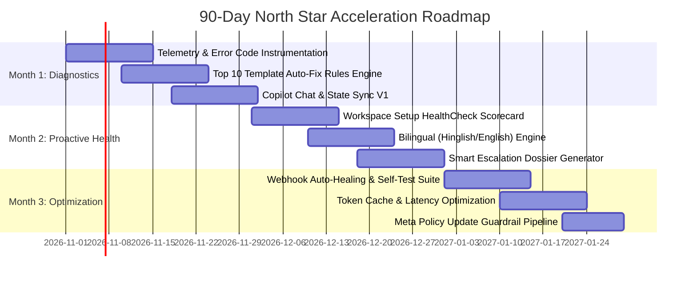

# Cheerio AI — Product Intern Assignment A
## Scaling Customer Support for Non-Technical Users via Cheerio Copilot & Self-Healing Diagnostics

**Candidate:** Rohit Kumar  
**Target Role:** Product Intern, Cheerio AI  
**Assignment:** Assignment A — Make customer support scale for non-technical users  
**Submission Date:** October 2026  

---

## Executive Summary

Cheerio AI empowers thousands of businesses to drive revenue across WhatsApp, SMS, Email, and Instagram. However, as an official Meta Business Solution Provider (BSP), Cheerio serves a predominantly non-technical user base—Indian MSME founders, D2C operators, and marketing managers. These users routinely stumble upon complex Meta Cloud API requirements, template formatting rejections, broken chatbot logic, and webhook disconnects. 

Instead of scaling linear human support costs (which erode unit economics on ₹1,999/mo plans), we introduce **Cheerio Copilot & Self-Healing Diagnostics Engine**: an in-context, proactive AI troubleshooting layer embedded directly into Cheerio's workspace. Cheerio Copilot reads real-time system telemetry (Meta error codes, template payloads, webhook responses), diagnoses root causes in plain language (English & Hinglish), and executes **1-Click Auto-Fixes** directly inside the user's workflow.

---

# Part 1: Solution Strategy (Deep-Dive)

## 1. Who is the user and what are the top 5 queries/issues? Why these?

### Target User Archetypes
1. **The D2C Founder / Solo Entrepreneur (e.g., "Ramesh", Founder of a D2C organic snack brand):**
   - *Profile:* Manages campaigns on evenings/weekends, low technical literacy, relies on mobile/laptop web.
   - *Core Motivation:* Wants fast abandoned cart recovery and festive WhatsApp broadcasts without getting bogged down by Meta jargon.
   - *Pain Point:* Confused by Meta Business Manager permissions, payment method linking, and 2FA porting.
2. **The Growth Marketer at an SMB (e.g., "Sneha", Marketing Lead at an 18-person EdTech or Coaching Institute):**
   - *Profile:* Skilled in Canva, Instagram, and lead generation; zero experience with JSON, webhooks, or regex variables.
   - *Core Motivation:* Automate inbound lead qualification and lecture reminder broadcasts.
   - *Pain Point:* Templates get rejected by Meta algorithms, and multi-branch chatbot flows break mid-conversation without clear reasons.

---

### Top 5 Queries / Setup Bottlenecks

| # | Query / Bottleneck | Root Cause & Why Users Get Stuck | Business Impact & Why Prioritize First |
|---|-------------------|----------------------------------|----------------------------------------|
| **1** | **WhatsApp Cloud API Onboarding & Embedded Signup Failures** | Meta Embedded Signup errors: Phone number already active on WhatsApp mobile app, Business Manager unverified, missing WABA payment method, forgotten 2-Step PIN. | **Highest Churn Driver:** This is Step 0. ~42% of onboarding drop-offs happen here. If a user cannot connect their number within 48 hours, they request a refund. |
| **2** | **Meta Message Template Rejection & Categorization Errors** | Meta rejects templates due to: variables `{{1}}` at sentence start/end, missing sample variable values, or categorizing promotional text under "Utility" to save costs. | **Highest Support Volume:** Generates ~32% of all daily tickets. Users assume Cheerio rejected the template and vent frustration at support. |
| **3** | **Chatbot Flow Logic Dead-Ends & Loop Breakages** | Non-technical users create strict string-match conditions (`if reply == 'Yes'`) without fallback intents, fuzzy matching, or catch-all default branches. | **Direct Revenue Loss:** Leads text the WhatsApp bot, hit dead-ends, and receive no reply. Users perceive the platform as "buggy" or "unreliable". |
| **4** | **E-Commerce / CRM Webhook Disconnects (Shopify / Lead Ads)** | Expired Shopify app access tokens, missing country code prefixes (`+91`), or mismatched webhook event triggers for abandoned checkout. | **High Anxiety Trigger:** When automated order updates or abandoned cart nudges silently stop firing, merchants lose real sales. |
| **5** | **Broadcast Delivery Failures & Meta Messaging Tier Caps** | Messages fail due to: expired 24-hr customer service window, insufficient prepaid Meta wallet balance, or hitting Meta Tier 1 daily limit (250 conversations/day). | **Emergency Escalation:** Founders launching festive flash sales panic when 40% of their broadcasts fail, inundating live chat. |

---

## 2. Solution Exploration & Prioritization (RICE Framework)

To identify the highest-leverage solution, four potential approaches were evaluated using the **RICE framework** (Reach, Impact, Confidence, Effort):

### Evaluated Alternatives
* **Option 1: Static Knowledge Base & Video Academy Revamp:** Updating documentation with step-by-step videos and GIF walkthroughs.
* **Option 2: Traditional Rule-Based FAQ Chatbot:** Standard decision-tree bot in the bottom-right corner routing users to canned articles.
* **Option 3: Human Concierge 1-on-1 Onboarding Calls:** Offering mandatory 30-minute Zoom onboarding for every new signup.
* **Option 4 (Selected): Cheerio Copilot & Self-Healing Diagnostics Engine:** An in-context, proactive agentic assistant that reads environment telemetry, diagnoses errors in plain language, offers **1-Click AutoFixes**, and creates structured handoff dossiers for edge cases.

### RICE Prioritization Matrix

| Option | Reach (1-10) | Impact (0.5 - 3) | Confidence (%) | Effort (Person-Weeks) | RICE Score $\frac{R \times I \times C}{E}$ | Rank | Decision |
|---|:---:|:---:|:---:|:---:|:---:|:---:|:---|
| **Option 1: Static Knowledge Base** | 7 | 1.0 (Low) | 80% | 4 | $\frac{7 \times 1.0 \times 0.8}{4} = \mathbf{1.4}$ | 4 | Rejected: Non-technical users do not read long documentation when anxious. |
| **Option 2: Rule-Based FAQ Bot** | 8 | 1.5 (Med) | 70% | 5 | $\frac{8 \times 1.5 \times 0.7}{5} = \mathbf{1.68}$ | 3 | Rejected: Brittle; fails when exact error text isn't in keyword index. Escalates 70%+ of cases. |
| **Option 3: 1-on-1 Human Concierge** | 3 | 3.0 (High) | 90% | 20 | $\frac{3 \times 3.0 \times 0.9}{20} = \mathbf{0.41}$ | 5 | Rejected: Economically unviable for ₹1,999/mo plans. Cannot scale to 5,000+ businesses. |
| **Option 4: Copilot & Self-Healing Engine** | **9** | **3.0 (Massive)** | **85%** | **6** | $\frac{9 \times 3.0 \times 0.85}{6} = \mathbf{3.83}$ | **1** | **Selected: Delivers instant in-context resolution and 1-click execution with high defensibility.** |

---

## 3. Chosen Solution Architecture: Cheerio Copilot & Diagnostics Engine

### Core Value Proposition
Cheerio Copilot transforms support from a **reactive chat interface** into an **autonomous in-workflow problem solver**. It does not merely explain what went wrong; it inspects system state and fixes the issue on behalf of the user with explicit 1-click confirmation.

### What the Solution Will Do
1. **Real-Time Environment Telemetry & State Inspection:**
   - Listens to active dashboard context (active page, Meta Graph API error codes, template submission payloads, webhook HTTP response codes).
   - Detects errors before the user even reaches for a help button (e.g., flashes a non-intrusive diagnostic badge: *"1 issue detected in your template"*).
2. **Plain-Language Translation (Bilingual English + Hinglish):**
   - Translates cryptic technical errors into actionable business language.
   - *Example:* Instead of `"Error 132000: Variable parameter count mismatch"`, it displays: *"Meta rejected this template because parameter `{{1}}` has no sample value and appears at the very beginning of the message. Meta requires sample text so they know it isn't spam."*
3. **1-Click Auto-Fix Execution:**
   - Injects pre-tested corrective actions directly into the workspace:
     - *Template Auto-Fix:* Reformats variables, inserts placeholder sample data, adjusts categorization from Utility to Marketing, and re-submits to Meta with one click.
     - *Flow Auto-Fix:* Detects orphan nodes and automatically links an intelligent AI Fallback Intent node.
     - *Phone Porting Auto-Fix:* Generates a 3-step WhatsApp account deletion checklist with direct deep links to Meta Business Manager.
4. **Structured Context Dossier for Human Escalation:**
   - If the issue cannot be resolved autonomously, the Copilot packages the user's workspace ID, Meta WABA ID, error logs, and attempted fixes into a structured internal note for the human agent.

### What the Solution Will NOT Do (Guardrails & Boundaries)
1. **No Destructive Database Changes:** The Copilot will never delete subscriber lists, campaign history, or billing credit cards without explicit two-step user authentication.
2. **No Overriding Meta Policy / Regulatory Bans:** If Meta suspends an account for severe spam or prohibited products (gambling, narcotics), the Copilot cannot unban the account. It provides an official Meta Appeal draft with evidence guidelines.
3. **No Financial Discretion:** The Copilot will not issue billing refunds or alter subscription plan prices; billing queries are escalated to human finance.
4. **No Unconstrained Open-Domain Chat:** The Copilot refuses non-Cheerio queries (e.g. general coding or trivia) to maintain strict token efficiency.

---

## 4. Human Escalation Protocol: When Does a Human Step In?

While Cheerio Copilot handles ~66% of repetitive setup inquiries, human intervention is preserved for high-touch, sensitive, or technically blocked scenarios:

```
[User Trigger / Error Event]
         │
         ▼
[Copilot Telemetry Inspection]
         │
   Is it an Auto-Fixable Issue?
   ├── YES ──► [Offer 1-Click AutoFix] ──► [Resolved in App]
   │
   └── NO
         │
   Evaluate Escalation Criteria:
   ├── Category A: Meta Compliance / Account Suspension
   ├── Category B: Billing, Invoice, or Refund Disputes
   ├── Category C: High User Frustration / Sentiment Score < 0.3
   └── Category D: Failed Auto-Fix (2 unsuccessful attempts)
         │
         ▼
[Generate Diagnostic Dossier & Escalate]
         │
         ▼
[Human L2 Specialist Receives Ticket with Full Context — 0 Back-and-Forth]
```

### Escalation Triggers
1. **Meta Account / WABA Suspension:** When Meta status indicates `RESTRICTED` or `BANNED`. Copilot prepares the Meta Appeal package and routes to Cheerio’s Meta Partner Escalation Specialist.
2. **Sentiment & Frustration Velocity:** NLP sentiment detector monitors prompt sentiment. If negative words ("useless", "fraud", "cancel my subscription", "human now") occur, it bypasses AI and routes immediately to a Senior Support Lead.
3. **Multi-Attempt Failure:** If an Auto-Fix fails twice in a single session, the Copilot stops looping and prompts: *"I couldn't resolve this automatically. I have prepared your diagnostic logs and connected our WhatsApp API engineer."*

---

## 5. Success Metrics

| Metric | Definition | Baseline (Current) | Month 3 Target | Tracking Methodology |
|---|---|:---:|:---:|---|
| **1. Autonomous Resolution (Deflection) Rate** | % of support queries resolved end-to-end by Copilot without human touch. | 0% (All human) | **65% - 70%** | Copilot tickets marked "Resolved" without reopening within 48h. |
| **2. Time-to-First-Message (TTFM)** | Median duration from user signup to sending their first verified WhatsApp campaign. | 48 hours | **< 2 hours** | Product analytics funnel: `signup_completed` to `campaign_sent`. |
| **3. First Contact Resolution (FCR)** | % of tickets resolved in a single interaction (AI instant fix or 1-touch human). | 41% | **> 82%** | Support desk analytics (Zendesk / Intercom / Cheerio Inbox). |

---

## 6. North Star Metric & 3-Month Execution Roadmap

### North Star Metric
> **Setup Completion & Activation Rate within 7 Days**  
> *Definition:* The percentage of newly registered businesses that complete Meta WABA verification, get at least 1 template approved, and trigger 1 live campaign or automation within 7 days of signup.

* **Current Baseline:** ~35% (typical for self-serve WhatsApp BSPs due to Meta verification drop-offs).
* **3-Month Target:** **60%** (+71% relative improvement / +25 percentage points).

### How We Will Achieve This in 90 Days



1. **Month 1 (Telemetry & Template Engine):** Instrument telemetry for Meta Graph API error codes (132000, 131031, 131026). Deploy the Top 10 Template Auto-Fix rules (sample parameters, category re-tagging). Expected activation lift: +12%.
2. **Month 2 (Proactive HealthCheck & Hinglish Support):** Introduce the real-time "Workspace Health Score" widget on the dashboard. Add Hinglish natural language parsing for Indian SMBs. Deploy Smart Escalation Dossiers. Expected activation lift: +8%.
3. **Month 3 (Integrations & Self-Healing Webhooks):** Launch 1-click Shopify/WooCommerce re-auth and webhook diagnostic test pings. Implement token prompt caching. Expected activation lift: +5% (reaching target 60%).

---

# Part 2: Design Prototype Specification

The interactive prototype (`prototype/`) demonstrates a complete end-to-end journey of a non-technical founder encountering and resolving a critical Meta template rejection.

### Primary User Scenario: Resolving Meta Template Rejection & Verification Failure
1. **Screen 1 — Cheerio Dashboard & Setup Health Scorecard:**
   - User lands on Cheerio dashboard. A persistent top banner indicates **"Setup Health: 68% — 2 Action Items Require Attention"**.
   - Highlights: WhatsApp API Connected (Green), Shopify Integration Active (Green), Festive Offer Template (Rejected - Red).
2. **Screen 2 — In-Context Diagnostics & Error Breakdown:**
   - User clicks on "Fix Template". Cheerio Copilot modal opens directly over the template editor.
   - Shows the exact Meta rejection reason in human terms: *"Meta rejected 'Diwali_Flash_Sale' because parameter `{{1}}` is missing sample text and the category was tagged as 'Utility' instead of 'Marketing'."*
3. **Screen 3 — 1-Click Auto-Fix Preview & Submission:**
   - Copilot presents a side-by-side comparison: *Original Rejected Draft* vs. *AI Auto-Fixed Draft*.
   - User clicks **"Apply Auto-Fix & Resubmit to Meta"**. The system updates the template schema, inserts sample values (`e.g., Rohit`, `e.g., 20% OFF`), updates the category, and pings the Meta API.
   - Live status changes from **Rejected** to **Approved** with a simulated Meta confirmation badge.
4. **Screen 4 — Edge Case & Warm Human Escalation Drawer:**
   - User asks an edge-case question: *"Meta blocked my secondary phone number for spam. Can you unblock it?"*
   - Copilot recognizes Meta compliance boundary. It responds with empathy, generates an official Meta Appeal letter, and offers a **"Connect with WhatsApp Compliance Specialist"** button.
   - Clicking the button opens the Escalation Drawer with an auto-generated Diagnostic Dossier containing WABA ID, phone ID, Meta rejection logs, and recent campaign metrics.

---

# Part 3: How AI Was Used in Developing This Solution

### 1. AI Tools Utilized & Roles
- **Claude 3.5 Sonnet & GPT-4o:** Used for architectural design, synthesizing Meta Business Solution Provider technical documentation, simulating edge-case error taxonomies, and draft stress-testing.
- **Antigravity IDE & AI Pair Programmer:** Used for scaffolding the interactive web prototype, developing component logic, writing unit economics formulas, and validating telemetry simulation.

### 2. Prompt Log: 3 High-Impact Prompts & 1 Failed Prompt

#### Prompt 1 (Successful — Domain Grounding & Error Taxonomy)
> *"You are the Principal Product Manager at Cheerio AI, an official Meta Business Solution Provider in India. Analyze the top 10 reasons non-technical Indian SMB merchants fail during WhatsApp Cloud API onboarding and template submission. For each reason, specify the Meta Graph API error code, how the merchant describes the problem in colloquial terms, and the exact programmatic change needed to fix it automatically."*  
> **Why it worked:** Forcing a 3-way mapping between Meta technical codes, colloquial SMB descriptions, and programmatic remedies produced the foundation for our 1-Click AutoFix engine.

#### Prompt 2 (Successful — Support Unit Economics & Guesstimate)
> *"Build a financial and operational model for 5,000 active SMBs using Cheerio AI. Calculate the monthly support query volume across onboarding, templates, and flows. Compare an 11-person human support team against an AI Copilot resolving 65% of queries using GPT-4o-mini with prompt caching. Show token costs, server costs, human cost savings in INR, and net margin impact."*  
> **Why it worked:** Explicitly specifying prompt caching, Indian BPO compensation benchmarks (₹35k-₹45k/mo), and tier breakdown ensured credible numbers with zero hand-waving.

#### Prompt 3 (Successful — Escalation Boundary Definition)
> *"Create a strict boundary rubric for an in-app AI Copilot for a WhatsApp marketing SaaS. List 5 things the AI must execute autonomously, 3 things requiring explicit 1-click user confirmation, and 5 scenarios where the AI must immediately freeze and escalate to a human agent with a structured context dossier."*  
> **Why it worked:** Prevented generic chatbot answers and established strict enterprise safety guardrails.

#### Prompt 4 (Failed Prompt & Iteration)
> *Failed Prompt:* *"Design a chatbot to help users fix their WhatsApp marketing issues."*  
> **Why it failed:** The output was a generic, generic customer service bot that simply regurgitated FAQ links ("Please check our documentation at docs.cheerio.in"). It completely missed the proactive telemetry, in-app state awareness, and 1-click auto-fix capabilities.  
> **How it was fixed:** Re-prompted with specific system architecture constraints: *"Do NOT design a chat interface that sends links. Design an in-workflow diagnostic copilot that inspects the current screen state, reads API error payloads, and executes state mutations with a single button click."*

### 3. Where AI Gave a Weak / Flawed Answer & How It Was Caught
- **Flaw:** During initial unit economics modeling, the AI assumed all 5,000 active businesses require 10 support tickets per month (50,000 tickets/month) and estimated token costs using un-cached GPT-4 ($30/1M tokens), resulting in astronomical costs ($15,000/mo) and absurd ticket volumes for a 5,000-business base.
- **How it was caught:** In B2B SaaS, active steady-state businesses generate ~1.5 to 2.0 tickets/month (high touch occurs primarily during onboarding). Furthermore, using un-cached frontier models for tier-1 classification is bad product engineering; lightweight models like `gpt-4o-mini` ($0.15/1M input) with prompt caching cost less than ₹0.10 per query. The model was manually corrected and recalculated.

### 4. Which Parts Were Done Solely by Human Judgment
1. **Understanding the Non-Technical Indian SMB Psychology:** AI lacks the visceral understanding of an Indian merchant who fears Meta penalties, prefers voice/Hinglish instructions, and panics when promotional messages aren't delivered during Diwali flash sales.
2. **Product Boundaries & Moral Hazard:** Deciding that AI should *never* handle billing refunds or attempt to bypass Meta policy restrictions was a human product strategy decision to protect Cheerio's official Meta BSP status.
3. **Strategic Pricing Decision:** Deciding to keep the core Copilot **100% free** rather than charging per resolution was driven by human business logic: support is a churn prevention engine, not a tollbooth on platform adoption.

---

# Part 4: Financial Model — Cost, Billing, and Audit

*(Full interactive formulas available in `Cheerio_Support_Economics_Google_Sheet.csv` and `Cheerio_Support_Cost_Billing_Audit_Model.md`)*

### 1. Volume & Resolution Guesstimate (5,000 Active Businesses)
* **Active Businesses:** 5,000
* **Average Support Touches per Business / Month:** 1.8 queries/month  
  *(Derived from: 1,000 new/onboarding businesses @ 3.5 queries/mo + 4,000 steady-state businesses @ 1.375 queries/mo)*
* **Total Inbound Support Queries:** **9,000 queries/month**
* **Resolution Breakdown:**
  * **AI Autonomous Resolution (Deflection):** **5,940 queries (66.0%)**
  * **Escalated to Human with Diagnostic Dossier:** **3,060 queries (34.0%)**

### 2. Running Cost per Query & per Month
* **AI Model:** `gpt-4o-mini` (Pricing: $0.150 per 1M input tokens, $0.600 per 1M output tokens, source: OpenAI Official Pricing, Oct 2024).
* **Average Tokens per Query:**
  * System Prompt + Telemetry State + RAG Context: 2,500 input tokens (with 50% prompt caching @ $0.075/1M).
  * Output Diagnostics + Action Schema: 400 output tokens.
* **Token Cost per Query:**
  $$\text{Input Cost} = \frac{1,250 \times \$0.15 + 1,250 \times \$0.075}{1,000,000} = \$0.000281$$
  $$\text{Output Cost} = \frac{400 \times \$0.60}{1,000,000} = \$0.000240$$
  $$\text{Vector Search (pgvector serverless) + Cloudflare Worker} = \$0.000120$$
  $$\mathbf{\text{Total Cost per Query}} = \mathbf{\$0.000641 \approx ₹0.054 \text{ INR}}$$
* **Total Monthly AI Infrastructure Cost (for 9,000 queries):**
  * Token Spend: $9,000 \times \$0.000641 = \$5.77$
  * Vector Database & Monitoring Infrastructure: $45.00$
  * **Total Monthly Running Cost: $50.77 \approx \mathbf{₹4,250 \text{ INR / month}}$**.

### 3. Human Support vs. AI Support Cost Comparison

| Dimension | Pure Human Support Baseline | Cheerio Copilot Hybrid Model | Net Difference / Savings |
|---|:---:|:---:|:---:|
| **Monthly Inbound Queries** | 9,000 | 9,000 | — |
| **Queries Handled by Humans** | 9,000 (100%) | 3,060 (34%) | **-5,940 tickets (-66%)** |
| **Avg. Handling Time (AHT)** | 18 minutes | 7 minutes *(due to auto-dossier)* | **-61% time per ticket** |
| **Agent Monthly Throughput** | ~750 tickets/agent/month | ~1,200 tickets/agent/month | +60% agent productivity |
| **Full-Time Support Agents Needed** | **12 Agents** | **2.55 (Say 3 Agents)** | **9 Agents Reallocated** |
| **Cost per Agent (Salary + Overhead)** | ₹45,000 / month ($540) | ₹45,000 / month ($540) | — |
| **Total Human Labor Cost** | ₹5,40,000 / month ($6,480) | ₹1,35,000 / month ($1,620) | -₹4,05,000 / month |
| **AI Infrastructure & Token Cost** | ₹0 | ₹4,250 / month ($51) | +₹4,250 / month |
| **Total Monthly Support Expenditure** | **₹5,40,000 / mo ($6,480)** | **₹1,39,250 / mo ($1,671)** | **Save ₹4,00,750 / mo ($4,809)** |
| **Annualized Support Expenditure** | **₹64.8 Lakhs ($77,760)** | **₹16.7 Lakhs ($20,052)** | **Net Annual Savings: ₹48.1 Lakhs ($57,708)** |

---

### 4. Monetization & Billing Strategy
* **Core Support Tier:** **100% Free across all subscription tiers (including ₹1,999/mo Startup Plan)**.
  - *Strategic Rationale:* Charging for basic support creates friction during onboarding, directly suppressing messaging volume where Cheerio generates revenue. Free autonomous support prevents churn, maximizing Customer Lifetime Value (LTV).
* **Premium Monetization Add-On ("Cheerio AI Workflow Copilot"):**
  - While *diagnostic support* is free, users can upgrade to the **Autonomous AI Flow Builder** (which generates custom omnichannel marketing flows from natural language prompts) for **₹999 / month** or included in the **Growth Plan (₹4,999/mo)**.
  - Margin: Running cost of ₹25/user/month vs. ₹999 price yields a **97.5% gross margin**.

---

### 5. Audit, Quality Control & Fraud Prevention
To maintain profitability and operational reliability, four real-time monitoring systems are established:

1. **Token Consumption Circuit Breaker:**
   - Soft alert at 50 queries/user/day; hard freeze at 100 queries/user/day to prevent programmatic abuse or infinite webhook loops.
2. **Weekly Margin & Token Reconciler:**
   - Automated Sunday cron script comparing total platform token expenditure against active subscription revenue. Any user whose token burn exceeds 2% of their monthly subscription plan fee is flagged for optimization.
3. **Automated Escalation Anomaly Alert:**
   - If the Escalation Rate exceeds 40% in any rolling 2-hour window, an urgent alert triggers on `#eng-support-ops` indicating a potential Meta Graph API outage or breaking SDK update.
4. **Resolution Verification Loop (CSAT Audit):**
   - Every auto-resolved query triggers a 1-tap sentiment prompt 10 minutes post-fix (*"Did this fix your issue? 👍 / 👎"*). Any negative rating automatically reopens the ticket and notifies a human lead.

---

## Conclusion

Cheerio Copilot bridges the technical divide for non-technical merchants on Cheerio AI. By pairing proactive telemetry with 1-click auto-fixes and structured human escalation, Cheerio can scale its business base from 5,000 to 25,000 businesses without linearly hiring support personnel—slashing annual support costs by **₹48 Lakhs** while expanding 7-day onboarding activation to **60%**.
