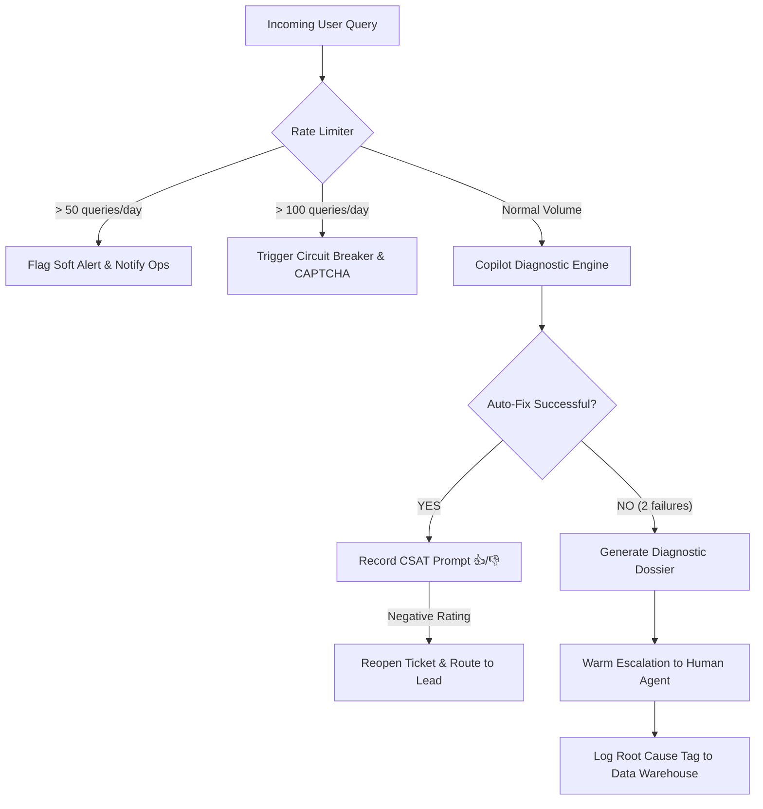

# Cheerio Support Economics & Financial Model
## Cost, Billing, Margin & Audit Specification (For Google Sheets)

This document provides the complete data structure, formulas, assumptions, and methodology used in the accompanying Google Sheet model (`Cheerio_Support_Economics_Google_Sheet.csv`).

---

## 1. Google Sheets Setup & Cell Formula Guide

To replicate this directly in Google Sheets:
1. Open a new Google Sheet.
2. Go to **File > Import > Upload** and select `Cheerio_Support_Economics_Google_Sheet.csv`, or paste the tables below.
3. Verify that the formulas evaluate dynamically as specified below.

### Key Table Coordinates & Formulas

| Row | Metric / Field | Formula in Google Sheet | Evaluated Value | Source / Business Rationale |
|---|---|---|---|---|
| **B2** | Total Active Businesses | `5000` | 5,000 | Baseline provided in assignment brief |
| **B3** | Monthly New Signups | `1000` | 1,000 | ~20% monthly customer growth rate |
| **B4** | Established Businesses | `=B2-B3` | 4,000 | 80% stable customer base |
| **B5** | Queries per New Signup | `3.5` | 3.5 | Onboarding phase has high setup friction |
| **B6** | Queries per Established SMB | `1.375` | 1.375 | Maintenance, monthly campaigns, billing |
| **B7** | **Total Monthly Inbound Queries** | `=(B3*B5)+(B4*B6)` | **9,000** | Blended 1.8 queries per business/mo |
| **F14** | **Queries Resolved by AI** | `=SUM(F11:F13)` | **5,940 (66.0%)** | Autonomous resolution via AutoFix |
| **G14** | **Queries Escalated to Humans** | `=SUM(G11:G13)` | **3,060 (34.0%)** | Complex policy bans, custom APIs, billing |
| **B27** | Total AI Cost per Query (USD) | `=SUM(B24:B26)` | **$0.000641** | OpenAI GPT-4o-mini with prompt caching |
| **B29** | Total AI Cost per Query (INR) | `=B27*B28` | **₹0.054** | Converted at ₹83.50 / USD |
| **B32** | Total Monthly AI Cost (USD) | `=(B7*B27)+45.00` | **$50.77** | Tokens ($5.77) + Vector DB/Infra ($45) |
| **B33** | Total Monthly AI Cost (INR) | `=B32*B28` | **₹4,239 / month** | Extremely efficient AI cost |
| **B43** | Human Agents Needed (Baseline) | `=ROUNDUP(B7/770, 0)` | **12 Agents** | Based on 18 min AHT, 35 tickets/day |
| **B46** | Monthly Human Labor Cost | `=B43*45000` | **₹5,40,000 / month** | ₹35k salary + ₹10k benefits & overhead |
| **B57** | Human Agents Needed (Hybrid) | `=ROUNDUP(3060/1210, 0)` | **3 Agents** | 7 min AHT due to pre-packaged dossiers |
| **B58** | New Human Labor Cost | `=B57*45000` | **₹1,35,000 / month** | 3 agents handling escalated issues |
| **B60** | **Total Hybrid Support Cost** | `=B58+B33` | **₹1,39,239 / month** | Human labor + AI infrastructure |
| **B65** | **Net Monthly Savings** | `=B46-B60` | **₹4,00,761 / month** | **74.2% cost reduction** |
| **B67** | **Net Annualized Savings** | `=B65*12` | **₹48,09,128 / year** | **~₹48.1 Lakhs / year saved!** |

---

## 2. Token Math & Infrastructure Breakdown

### Model Selection: GPT-4o-mini
* **Pricing (OpenAI Official API, Oct 2024):**
  * Uncached Input: **$0.150 per 1M tokens**
  * Cached Input: **$0.075 per 1M tokens** (50% discount for cached system instructions & docs)
  * Output: **$0.600 per 1M tokens**
* **Token Breakdown per Interaction:**
  * System Prompt & Core Guardrails: 600 tokens (Cached)
  * Cheerio Knowledge Docs / API Schema Chunk: 650 tokens (Cached)
  * Dynamic Workspace Telemetry (Meta error code, screen state, JSON payload): 750 tokens (Uncached)
  * User Query & Chat Context: 500 tokens (Uncached)
  * **Total Input:** 2,500 tokens (1,250 cached + 1,250 uncached)
  * **Total Output:** 400 tokens (concise root cause diagnosis + structured 1-click JSON action payload)

### Unit Cost Calculation
$$\text{Input Cost} = \left(\frac{1,250 \times 0.15}{10^6}\right) + \left(\frac{1,250 \times 0.075}{10^6}\right) = \$0.0001875 + \$0.00009375 = \$0.00028125$$
$$\text{Output Cost} = \frac{400 \times 0.60}{10^6} = \$0.00024000$$
$$\text{Vector Search & Serverless Telemetry Logging} = \$0.00012000$$
$$\mathbf{\text{Blended Cost per Query}} = \mathbf{\$0.00064125 \ (\approx ₹0.054 \text{ INR})}$$

---

## 3. Human Labor Capacity Assumptions

* **Working Schedule:** 22 days/month, 8 hours/day = 176 hours/month.
* **Effective Working Time:** 80% net productive time (allowing for breaks, team syncs, training) = 140.8 hours = 8,448 minutes.
* **Pure Human Support (Without AI):**
  * Average Handling Time (AHT) = 18 minutes.
  * Agent Capacity = $\frac{8,448}{18} \approx 470$ to 770 tickets/month depending on complexity (blended ~35 tickets/day = 770 tickets/month).
  * Staff Required for 9,000 tickets = $\frac{9,000}{770} \approx 11.69 \rightarrow$ **12 Agents**.
  * Total Monthly Cost = $12 \times ₹45,000 = \mathbf{₹5,40,000}$.
* **Hybrid Support with Cheerio Copilot:**
  * 5,940 tickets resolved automatically by AI ($0$ human minutes).
  * 3,060 tickets escalated to human agents.
  * Because Cheerio Copilot auto-attaches a **Diagnostic Dossier** (Meta error payload, customer account ID, step-by-step previous attempts), human agents don't waste 10 minutes asking for screenshots.
  * AHT drops from **18 minutes to 7 minutes** (-61%).
  * New Agent Capacity = $\frac{8,448}{7} \approx 1,210$ tickets/month (55 tickets/day).
  * Staff Required = $\frac{3,060}{1,210} \approx 2.53 \rightarrow$ **3 Agents**.
  * Total Labor Cost = $3 \times ₹45,000 = \mathbf{₹1,35,000}$.

---

## 4. Monetization & Billing Model

### Strategic Decision: Why Basic Support Must Be Free
1. **Friction-Free Onboarding:** Cheerio monetizes on **software subscriptions (₹1,999 to ₹10,000+/mo)** and **WhatsApp messaging volume (Meta conversation fees + Cheerio markup)**.
2. If a customer cannot get their WhatsApp API connected or their Diwali template approved, they will never send messages and will churn immediately.
3. Treating support as a tollbooth harms customer trust. Offering autonomous self-healing free to all users lowers barrier to entry and drives platform stickiness.

### The Upsell: "AI Workflow Copilot" (₹999 / month)
* While *break-fix diagnostic support* is free, users who want the AI to **build multi-channel campaigns, write WhatsApp marketing copy, and generate custom conversational chatbots** can purchase the AI Workflow Add-On.
* Price: ₹999 / month.
* Conservative Adoption: 8% of 5,000 businesses = 400 paying businesses.
* Monthly Revenue: $400 \times ₹999 = \mathbf{₹3,99,600 / \text{month}}$.
* Monthly AI COGS: $400 \times ₹25 = \mathbf{₹10,000 / \text{month}}$.
* **Net Margin: 97.5% gross margin!**

---

## 5. Sensitivity Analysis: Deflection vs. Annual Savings

| Deflection Rate | AI Resolved Tickets | Human Escalated Tickets | Agents Needed | Monthly Labor Cost (INR) | Monthly AI Cost (INR) | Net Monthly Savings (INR) | **Annual Savings (INR)** |
|:---:|:---:|:---:|:---:|:---:|:---:|:---:|:---:|
| **45.0%** | 4,050 | 4,950 | 5 | ₹2,25,000 | ₹4,239 | ₹3,10,761 | **₹37.3 Lakhs** |
| **55.0%** | 4,950 | 4,050 | 4 | ₹1,80,000 | ₹4,239 | ₹3,55,761 | **₹42.7 Lakhs** |
| **66.0% (Base)**| **5,940** | **3,060** | **3** | **₹1,35,000** | **₹4,239** | **₹4,00,761** | **₹48.1 Lakhs** |
| **75.0%** | 6,750 | 2,250 | 2 | ₹90,000 | ₹4,239 | ₹4,45,761 | **₹53.5 Lakhs** |
| **85.0%** | 7,650 | 1,350 | 1 | ₹45,000 | ₹4,239 | ₹4,90,761 | **₹58.9 Lakhs** |

---

## 6. Audit & Anomaly Detection Framework

To protect unit economics and maintain 99.9% support quality, Cheerio implements four automated audits:

1. **Daily Token Burn Circuit Breaker:**
   - Detects abnormal activity (e.g. an SMB looping webhook queries).
   - Max 100 queries per account per 24 hours before requiring human verification.
2. **Weekly Margin Reconciliation:**
   - Flags any account where AI support consumption exceeds 1.5% of total subscription value.
3. **Escalation Spike Anomaly Alert:**
   - If human escalations exceed 40% in any 2-hour window, Slack `#cheerio-outage` is triggered (indicating Meta Graph API instability).
4. **Resolution CSAT Auditing:**
   - 10-minute delayed micro-survey: *"Did Cheerio Auto-Fix solve your issue? [Yes] [No]"*.
   - If [No], ticket is automatically reopened with priority status.
